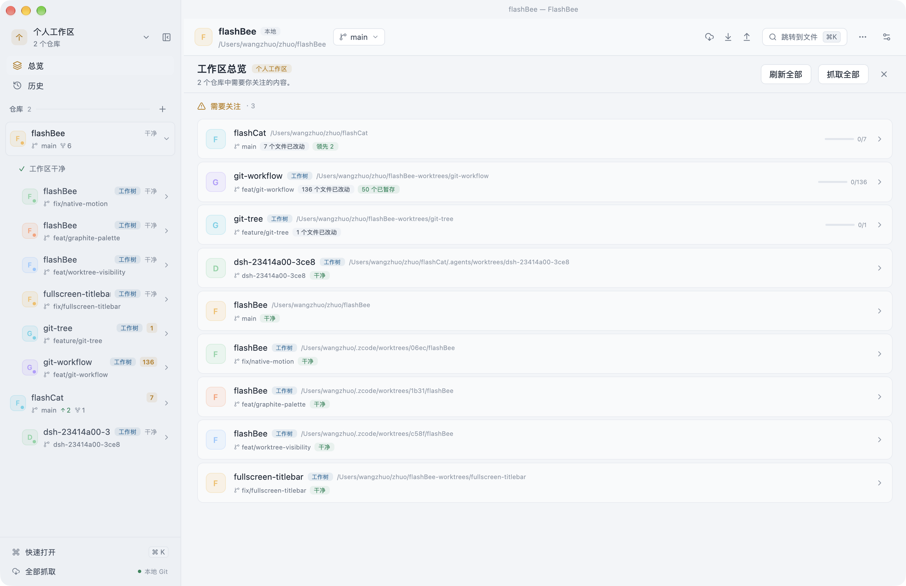

# FlashBee

A calm, native macOS Git workspace for reviewing changes across many local repositories — built with [GPUI](https://www.gpui.rs/), the GPU-accelerated UI framework behind Zed.

FlashBee reads repositories directly from disk, never uploads them, and keeps the whole review flow — workspaces, repository tree, branches, diffs, history, and commits — in one native window.



## Highlights

- **Native GPUI app** — no webview and no Node runtime at launch. Custom title bar, system fonts, Metal rendering, and a warm daylight / midnight palette.
- **Multi-repository workspaces** — add a repository, or point at a parent folder to discover every Git repository below it. Discovered repositories stay together in a collapsible folder group.
- **Linked worktrees** — `git worktree` checkouts appear nested under their repository with their own branch, ahead/behind state, and changes.
- **Staged and unstaged views** — a partially staged file appears in both groups with the correct diff for each side.
- **Stage, unstage, discard** — file-level and hunk-level actions. Discards are confirmed before anything is written.
- **Commit and push** — write a message, amend the previous commit, or commit & push in one flow. The push dialog reviews the commits that would land on the remote and supports selective commits, tags, and `--force-with-lease`.
- **Fetch, pull, push** — fetch one repository or the whole workspace, optionally in the background. Pull keeps merge conflicts in the resolver.
- **Branch manager** — search, create, switch, merge, rename, and delete local branches. Branches checked out elsewhere open their worktree instead of failing; unmerged branches require an explicit force delete.
- **Worktree manager** — list every checkout attached to a repository, add a worktree on a new or existing branch, open it in the workspace, remove clean or dirty worktrees, and prune stale records.
- **Branches and stashes** — switch or create a branch; if the working tree is dirty, stash it first. Stashes can be saved, restored, and dropped in place.
- **Merge conflict resolver** — side-by-side and unified conflict views, take either side per conflict, take a whole file, or resolve files where only one side changed. Resolved files are staged; the merge can be completed or aborted.
- **Diff review** — split or unified layout, syntax highlighting, word-level emphasis on paired lines, inline author/commit details on hover, image before/after comparison, binary and Git LFS notices.
- **Review progress** — mark files reviewed, watch progress per repository, filter to unreviewed / generated / whitespace-only changes, and filter by file name.
- **Workspace overview** — an attention inbox that sorts repositories by conflicts, merge state, uncommitted changes, and remote drift.
- **History** — commit log with a lane gutter, per-file history, commit details, and a diff between any two refs.
- **Cross-repository search** — `⌘K` searches repositories, changed files, commit messages, and file contents (ripgrep when available, `git grep` otherwise).
- **Local settings** — appearance, interface language (English / 简体中文), interface and code sizes, and auto-fetch. Workspaces, settings, window bounds, and review progress stay on this Mac.

## Requirements

- macOS 11 or newer
- Xcode command line tools (GPUI renders with Metal)
- Rust stable 1.85+ (the workspace uses edition 2024)
- Git on `PATH`

## Run

```bash
cargo run -p flashbee
```

For an optimized build:

```bash
cargo run --release -p flashbee
```

## Build a `.app`

```bash
./scripts/bundle-macos.sh          # FlashBee.app
./scripts/bundle-macos.sh --dmg    # FlashBee.app + FlashBee.dmg
```

The bundle is written to `target/release/bundle/macos/FlashBee.app`. It is ad-hoc signed so it launches locally; for distribution, sign it with your Developer ID and notarize it.

## Test

The Git engine is UI-independent and covered by integration tests that create real repositories on disk:

```bash
cargo test -p flashbee-git
```

Coverage includes staging and unstaging files and hunks, commits and amends, discards, branch switching with stash protection, branch listing with worktree ownership, branch create/rename/delete/merge (including conflicts), worktree add/remove/prune, stashes, fetch, push, pull, conflict resolution, history, ref comparison, and both search paths.

## Architecture

```
crates/
  flashbee-git/    Local Git engine: inspection, snapshots, staging, commits,
                   branches, stashes, remotes, history, search, conflicts.
  flashbee-app/    GPUI desktop app: state, views, themes, i18n, text inputs,
                   syntax highlighting, diff rendering, persistence.
scripts/
  bundle-macos.sh  Builds a locally signed .app (and optional .dmg).
demo/              Archived browser-first version, kept as a reference.
```

All Git work runs through the local `git` binary on a background thread pool. The UI never blocks on a repository, and in-flight results are guarded so stale snapshots cannot overwrite newer state.

User data lives in `~/Library/Application Support/com.flashbee.app/` (`workspaces.json`, `settings.json`, `layout.json`, `window-state.json`, `reviews.json`). The directory is shared with the earlier Tauri build, so existing workspaces and preferences carry over.

## Keyboard shortcuts

| Action | Shortcut |
| --- | --- |
| Quick open / search | `⌘ K` |
| Add repository | `⌘ O` |
| New workspace | `⇧ ⌘ N` |
| Refresh repository | `⌘ R` |
| Fetch | `⇧ ⌘ F` |
| Open commit composer | `⌘ ↵` |
| Open history | `⇧ ⌘ H` |
| Open workspace overview | `⇧ ⌘ O` |
| Manage branches and worktrees | `⇧ ⌘ B` |
| Split / unified diff | `⌘ 1` / `⌘ 2` |
| Toggle split / unified | `S` |
| Previous / next file | `K` / `J` |
| Toggle reviewed | `⇧ ⌘ R` |
| Stage all | `⇧ ⌘ A` |
| Copy change summary for a PR | `⇧ ⌘ C` |
| Toggle sidebar | `⌘ \` |
| Settings | `⌘ ,` |
| Close overlay | `Esc` |
| Quit | `⌘ Q` |

## Privacy

FlashBee has no account, no telemetry, and no cloud sync. It reads repositories from disk with the local `git` binary. Network access happens only when you fetch, pull, or push, using the remotes you configured.

## License

MIT
